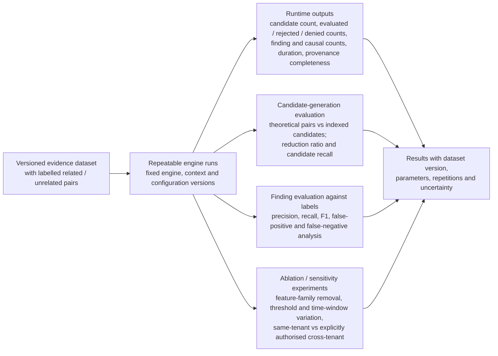

# Enhanced Correlation Engine Architecture

This architecture below describes the implemented correlation pipeline in `correlation/`. 

## Figure 1. Analysis Pipeline

```mermaid
flowchart TD
    subgraph INPUT[Analysis request]
        HOST[Host evidence records]
        INSTANCE[Instance EvidenceEvent records]
        CONTEXT[CorrelationContext<br/>tenant scope, time range, privacy mode,<br/>permitted features, threshold, temporal window]
        API[CorrelationEngine.process]
        HOST --> API
        INSTANCE --> API
        CONTEXT --> API
    end

    subgraph PREP[1. Canonicalisation and enrichment]
        NORMALISE[EvidenceNormaliser<br/>host and instance adapters]
        CANON[CanonicalEvidence<br/>identity, tenant, event time, collection time,<br/>actor, resource, raw bytes, SHA-256, provenance]
        UNIQUE{Unique evidence IDs<br/>within analysis?}
        ATTR[AttributeExtractor<br/>canonical fields + source attributes]
        ENTITY[EntityExtractor<br/>tenant, project, instance, user,<br/>resource, process; stable IDs]
        REL[RelationshipMapper<br/>belongs_to, acted_on, occurred_on]
        API --> NORMALISE --> CANON --> UNIQUE
        UNIQUE -- no --> ERROR[Fail analysis with duplicate-ID error]
        UNIQUE -- yes --> ATTR
        ATTR --> ENTITY
        ENTITY --> REL
    end

    subgraph GENERATE[2. High-recall candidate generation]
        INDEX[CandidateIndex<br/>temporal timestamp index + entity/resource/actor blocks]
        PAIRS[Unique evidence pairs<br/>blocking keys explain candidate admission]
        ENRICH[CandidateGenerator<br/>tenant IDs, shared entities/resources,<br/>actions, evidence references, provenance]
        CAND[Deterministic CorrelationCandidate set]
        ATTR --> INDEX
        ENTITY --> INDEX
        CANON --> INDEX
        INDEX --> PAIRS --> ENRICH --> CAND
    end

    subgraph AUTHORISE[3. Scope and policy gates]
        SCOPE{Candidate belongs to this analysis?<br/>Evidence IDs resolve; tenant attribution agrees;<br/>requested tenant and time constraints pass}
        POLICY{CrossTenantPolicy<br/>same tenant, or cross-tenant enabled<br/>and optional tenant-pair allowlist passes?}
        DENIED[Count as policy/scope denied;<br/>do not score or create a finding]
        CAND --> SCOPE
        CONTEXT --> SCOPE
        SCOPE -- no --> DENIED
        SCOPE -- yes --> POLICY
        CONTEXT --> POLICY
        POLICY -- no --> DENIED
    end

    subgraph SCORE[4. Explainable correlation scoring]
        SCORER[CorrelationScorer<br/>temporal 0.25; entity 0.25;<br/>resource 0.20; action 0.15;<br/>provenance 0.15 by default]
        FEATURES[Feature values, weights, contributions,<br/>evidence attributes used and explanations<br/>permitted features are renormalised]
        PASS{Score >= context minimum score?}
        REJECT[Rejected candidate;<br/>increment rejection count]
        POLICY -- yes --> SCORER --> FEATURES --> PASS
        CONTEXT --> SCORER
        PASS -- no --> REJECT
    end

    subgraph CAUSE[5. Optional causal interpretation]
        REASONER[CausalReasoner<br/>pair candidates only]
        ACTION[Resolve supported actions<br/>and establish trustworthy event order]
        CHECK[Match explicit causal vocabulary;<br/>check temporal window and, when required,<br/>shared-resource compatibility]
        LINK[Zero or more explainable links<br/>REQUIRES / PROVIDES / ENABLES<br/>with confidence and rationale]
        NO_LINK[No supported causal link<br/>is a valid result]
        PASS -- yes --> REASONER --> ACTION --> CHECK --> LINK
        CHECK --> NO_LINK
        CONTEXT --> REASONER
    end

    subgraph FIND[6. Findings and derived graph]
        BUILD[Build CorrelationFinding<br/>score + explanations + policy decision +<br/>source references + SHA-256 provenance + causal assessment]
        DEDUPE[Deterministic finding de-duplication]
        GRAPH[EvidenceGraphBuilder<br/>accepts final policy-approved findings only]
        NODES[Nodes: events, tenants, projects, instances,<br/>entities/resources and findings]
        EDGES[Edges: occurred-in, entity relationships,<br/>supports-finding, correlated-with, causal relation]
        RESULT[CorrelationResult<br/>findings + evidence graph + counts + duration +<br/>candidate reduction + provenance completeness + warnings]
        PASS -- yes --> BUILD
        LINK -. supplements; does not gate .-> BUILD
        NO_LINK -. supplements; does not gate .-> BUILD
        BUILD --> DEDUPE --> GRAPH
        CANON --> GRAPH
        ENTITY --> GRAPH
        REL --> GRAPH
        GRAPH --> NODES
        GRAPH --> EDGES
        DEDUPE --> RESULT
        GRAPH --> RESULT
        CONTEXT --> RESULT
    end

    classDef control fill:#fff3cd,stroke:#9a6700,color:#24292f;
    classDef data fill:#eaf5ff,stroke:#0969da,color:#24292f;
    classDef result fill:#e9f7ef,stroke:#1a7f37,color:#24292f;
    class SCOPE,POLICY,PASS,UNIQUE control;
    class CANON,CAND,FEATURES,LINK,NODES,EDGES data;
    class RESULT result;
```



## Figure 2. Module and Data Boundaries

```mermaid
flowchart LR
    subgraph ORCH[correlation.engine: CorrelationEngine]
        direction TB
        E[process(evidence_items, context)]
        E --> N[normaliser]
        E --> X[attribute extractor]
        E --> EN[entity extractor]
        E --> RM[relationship mapper]
        E --> CG[candidate generator]
        E --> P[cross-tenant policy]
        E --> S[scorer]
        E --> C[causal reasoner]
        E --> D[finding de-duplication]
        E --> G[graph builder]
    end

    RAW[(Authoritative evidence<br/>host records / agent events)] --> N
    CTX[CorrelationContext<br/>immutable per-analysis configuration] --> E
    N --> CE[CanonicalEvidence]
    CE --> X
    X --> EN
    EN --> ER[EvidenceEntity]
    EN --> RM
    RM --> REL[EvidenceRelationship]
    CE --> CI[CandidateIndex]
    ER --> CI
    CI --> CG
    CG --> CC[CorrelationCandidate<br/>evidence IDs + blocking reasons + references]
    CC --> P
    P -->|authorised| S
    S --> CS[CorrelationScore<br/>feature-level explanation]
    CS -->|passed| C
    C --> CL[CausalReasoningResult<br/>may contain no links]
    CS --> D
    CL --> D
    D --> CF[CorrelationFinding]
    CF --> G
    CE --> G
    ER --> G
    REL --> G
    G --> EG[EvidenceGraph<br/>derived, provenance-linked view]
    CF --> CR[CorrelationResult]
    EG --> CR

    LEGACY[SameTenantTemporalRule<br/>baseline comparator; stored in engine.rules<br/>but not invoked by process()] -. not on active path .-> E
```

## Figure 3. Research Evaluation Boundary



The third figure separates values emitted by the current engine from experiment-derived measures. Runtime metadata includes candidate reduction, counts, duration, and provenance completeness. Precision, recall, F1, candidate recall, and uncertainty require a labelled evaluation set and must be calculated by the research harness; they are not claims made by the engine itself.

## Design Notes

- **Candidate generation is a retrieval stage, not a decision.** The current index creates pairs from temporal, entity, resource, and actor blocks. Tenant is checked later by scope enforcement and `CrossTenantPolicy`; tenant blocking is disabled in the active `CandidateGenerator` configuration.
- **Scope and authorisation are separate gates.** Scope verifies that evidence and requested tenant/time boundaries agree. Policy then makes the explicit same-tenant or cross-tenant decision. Missing tenant attribution fails closed.
- **Correlation is not causation.** A score-passing candidate becomes a finding whether or not the causal reasoner produces a link. The causal layer currently supports pairs and emits directional, rule-backed `REQUIRES`, `PROVIDES`, or `ENABLES` links only when its action, ordering, time-window, and resource checks pass.
- **Scoring is explainable weighted support, not probability.** Default weights are temporal 0.25, entity 0.25, resource 0.20, action 0.15, and provenance 0.15. The context supplies the threshold and permitted feature set; the remaining feature weights are renormalised.
- **The graph is a derived view.** It contains evidence referenced by final policy-approved findings, preserving source hashes and support edges. A `CORRELATED_WITH` edge explicitly does not imply causation.
- **Legacy rule handling must not be drawn as active execution.** `SameTenantTemporalRule` is retained as a baseline comparator and appears in `engine.rules`, but `CorrelationEngine.process()` does not call it.
- **Current evaluation hooks support performance and integrity claims, not accuracy by themselves.** Candidate reduction and execution counters are emitted by the engine. Accuracy requires labelled ground truth; report candidate recall separately from finding-level precision/recall so candidate-generation misses are visible.

## Reporting

For each experiment, record dataset and label-set versions, engine and configuration versions, privacy mode, tenant scope, temporal window, minimum score, permitted feature families, and repeat count. Report candidate reduction and candidate recall together, then finding-level precision, recall, F1, false-positive/false-negative examples, runtime, and provenance completeness. Include threshold/window sensitivity and feature ablations; state explicitly that causal links are deterministic rule-based interpretations, not proof of causation.